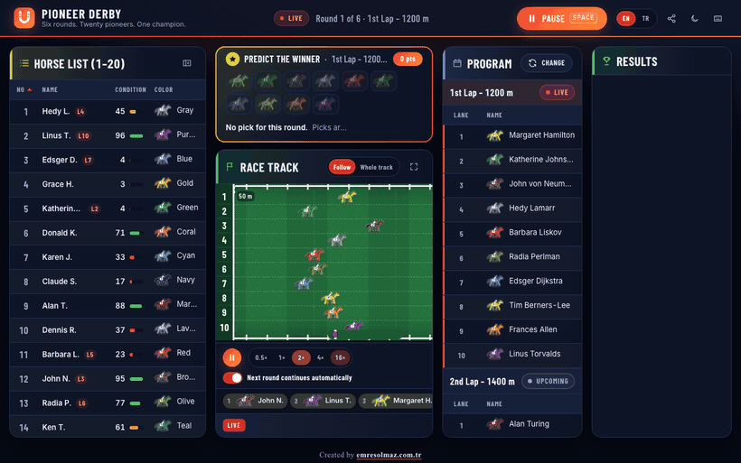
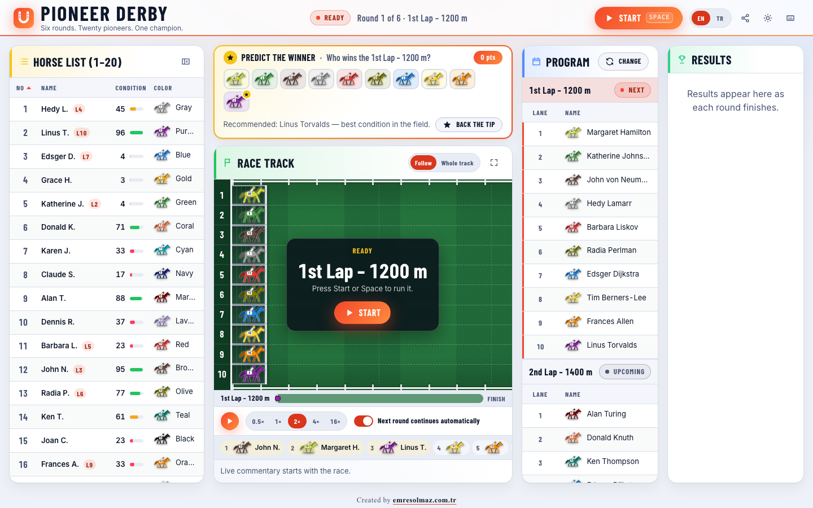
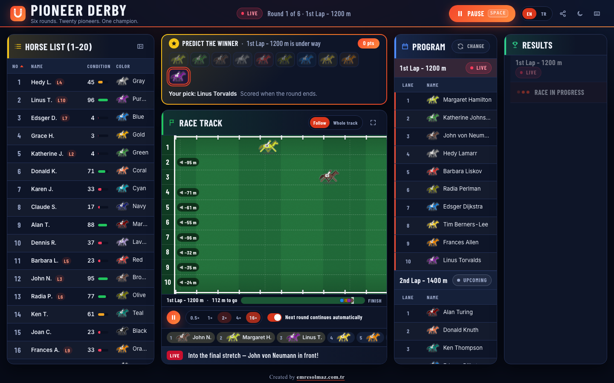
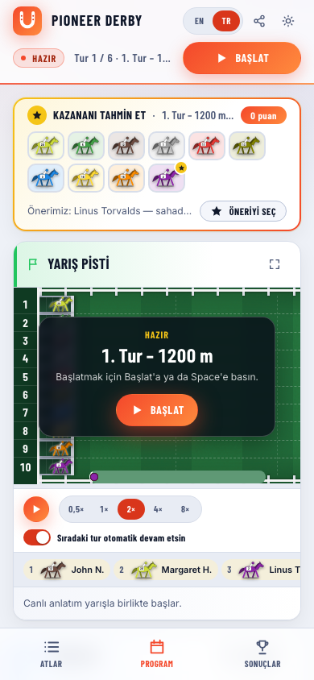
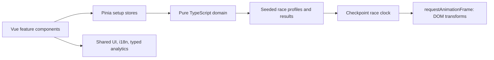
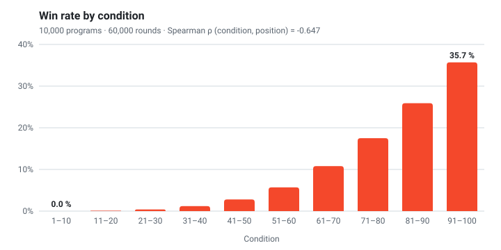

# Pioneer Derby 🏇

[](https://github.com/emrslmz/pioneer-derby/actions/workflows/ci.yml)
[](https://pioneerderby.netlify.app)


An interactive horse racing game built with **Vue 3, TypeScript and Pinia** for a front-end developer case study.
Twenty horses — named after computing pioneers — race across six rounds from 1200 m to 2200 m.

**Try it: [pioneerderby.netlify.app](https://pioneerderby.netlify.app)** (a first visit starts with a short guided tour).



The game includes the brief's full flow and optional predictions, replay, horse statistics and a live broadcast camera. See the [implementation plan](docs/PLAN.md) for delivery status.

## Playing

Generate the program, optionally pick a winner in the strip above the track, then press Start. Start runs the whole program one round at a time. Between rounds the result stays on the track for a 6-second countdown, with **Start now** to skip it. To decide when each round starts, switch off **Next round continues automatically** in the player bar under the track; every round then waits for **Next round**.

Horses run at a real racing pace: 16.5 m/s, so 1200 m takes about 73 seconds. The default playback is 2×; the player bar also offers 0.5×, 1×, 4× and 16×, and the keys `0` `1` `2` `4` `9` change speed too (`9` is 16×).

The **Follow** camera is true scale. A horse is as long on screen as a real horse is on the track, so about 20–30 m are in view. Horses left behind show their gap to the leader, and the line under the track shows the leader's distance to go. **Whole track** fits the full distance, and full screen opens the same live panel in a modal. A horse that has finished stands still. Pausing mid-race shows a "Paused" card, never a result.

When the sixth round is over, a **program summary** opens: the champion, how your predictions did, a chart of wins and podiums, and the winner of each round, with Replay. It can be opened again from the Results panel.

A first visit starts with a short guided tour (driver.js) that asks your language first. It resumes after a reload and can be taken again from the help dialog (`?`) or with `?tour=1`. The app opens in the light theme; the toggle in the header changes it. On wide screens the horse list folds into a rail of horses, and the Results panel shows each horse as it crosses the line.

## Screens

| Desktop, light                               | Desktop, dark, a race under way                         | Phone, Turkish                     |
| -------------------------------------------- | ------------------------------------------------------- | ---------------------------------- |
|  |  |  |

The media are generated from the seeded game by `npm run media`.

## Architecture



The store owns state transitions and one timer per round. The domain computes seeded outcomes before animation; the track derives positions from the clock without per-frame Pinia writes. [Architecture](docs/ARCHITECTURE.md) and [ADRs](docs/adr/README.md) explain the tradeoffs.

## Highlights

- Deterministic, seeded race engine — every race can be replayed and shared
- Fully responsive (mobile, tablet, desktop), light & dark themes
- Turkish 🇹🇷 and English 🇬🇧 UI
- "Predict the winner" engagement layer with a recommended horse
- Unit, property-based, E2E, accessibility and visual tests
- Fairness simulation proving how condition affects winning chances

## Testing & evidence

Every claim is measured, and every requirement ID from the brief is traced to the tests that prove it:
[**docs/TRACEABILITY.md**](docs/TRACEABILITY.md) (generated, checked in CI).

| Layer            | Tool                             | What it proves                                                                               |
| ---------------- | -------------------------------- | -------------------------------------------------------------------------------------------- |
| Unit & component | Vitest, @vue/test-utils          | Game rules, stores (fake clock), components' ARIA contracts                                  |
| Property-based   | fast-check                       | Every rule holds for any seed; any mix of pause / speed changes gives the seeded results     |
| Statistical      | Vitest + `domain/fairness.ts`    | Average position improves with every step up in condition; outsiders can still win           |
| Architecture     | ESLint API in Vitest             | Forbidden imports (domain → Vue, feature → feature, …) are rejected                          |
| End-to-end       | Playwright                       | The brief's full flow, keyboard-only play, persistence, sharing, replay                      |
| Accessibility    | @axe-core/playwright             | 0 serious / critical WCAG 2.2 AA issues — idle, racing, results, podium, both themes, mobile |
| Visual           | Playwright screenshots           | 3 devices × 2 themes × 2 languages, plus clock-frozen race frames                            |
| Performance      | Playwright + PerformanceObserver | Frame timing and long tasks while racing                                                     |

**Performance** (Chromium, 4 s of racing at 4×): **60 fps** median, p95 frame 16.8 ms, **0 long tasks**.
Horses move by `transform` only and nothing is written to Pinia per frame
([ADR 0005](docs/adr/0005-race-clock-checkpoints.md), [ADR 0008](docs/adr/0008-paint-runners-directly.md)).

**Visual baselines** are Linux screenshots made by CI, so they match the CI renderer exactly. When a
change alters the UI on purpose, the **Visual tests** job fails and uploads the new screenshots as the
`visual-baselines` artifact. Pull them, review the diff and commit:

```bash
npm run visual:pull -- <run-id>   # refuses if any screenshot differs between CI retries (flaky)
git diff --stat tests/visual/__snapshots__
```

Locally, `npm run test:visual:update` writes macOS baselines (git-ignored) for quick checks.

## Quality gates

Every pull request has to pass these checks in CI before it is merged (a required status check each):

| Gate                | Tool                                | Threshold                                           | Measured on `main`                |
| ------------------- | ----------------------------------- | --------------------------------------------------- | --------------------------------- |
| Lint and formatting | oxlint, ESLint boundaries, Prettier | 0 errors, architecture boundaries enforced          | clean                             |
| Types               | vue-tsc, strict                     | 0 errors                                            | clean                             |
| Unit and property   | Vitest, fast-check                  | domain 95 %, stores 90 % coverage                   | domain 100 %, stores 99 %         |
| End to end          | Playwright                          | all flows green (fake clock, seeded)                | 62 tests                          |
| Visual              | Playwright screenshots              | Linux baselines, light and dark, EN and TR          | 14 screens                        |
| Accessibility       | axe (WCAG 2.2 AA)                   | 0 serious or critical violations                    | 0, including the tour and dialogs |
| Performance         | Lighthouse CI, 3 runs, median       | 90 performance, 95 accessibility and best practices | 95 to 96 · 100 · 100 · 100 (SEO)  |
| Bundle              | `scripts/check-bundle.ts`           | JS 120 KiB, CSS 30 KiB, all assets 650 KiB (gzip)   | JS 92 · CSS 14 · all 480 KiB      |
| Requirements traced | `scripts/traceability.ts`           | every requirement ID has a test                     | 33 of 33                          |

## Deployment

Netlify builds `main` on every merge and creates a **deploy preview for each pull request**
([`netlify.toml`](netlify.toml): build, immutable caching of hashed assets, security headers).
GitHub Actions is the gate; Netlify only publishes what has passed review. Decision:
[ADR 0014](docs/adr/0014-netlify-delivery-and-quality-gates.md).

## Fairness

Does condition matter, and can an outsider still win? The race engine is played thousands of times
with seeded randomness ([ADR 0001](docs/adr/0001-deterministic-race-engine.md)):

<!-- fairness:start -->

<picture>
  <source media="(prefers-color-scheme: dark)" srcset="docs/fairness-dark.svg">
  
</picture>

**10,000 programs · 60,000 rounds.** Spearman ρ between condition and
finishing position: **-0.647** · best-conditioned runner wins **40.4 %** of rounds
(chance: 10 %) · a horse outside the top-3 conditions wins **18.8 %** — favourites usually, not always.

| Condition | Runs   | Win rate | Podium rate | Avg. position |
| --------- | ------ | -------- | ----------- | ------------- |
| 1–10      | 60,127 | 0.0 %    | 1.0 %       | 8.35          |
| 11–20     | 59,626 | 0.1 %    | 3.2 %       | 7.79          |
| 21–30     | 61,179 | 0.4 %    | 7.3 %       | 7.15          |
| 31–40     | 59,494 | 1.2 %    | 13.2 %      | 6.51          |
| 41–50     | 59,458 | 2.8 %    | 21.5 %      | 5.83          |
| 51–60     | 59,901 | 5.7 %    | 30.6 %      | 5.14          |
| 61–70     | 60,199 | 10.8 %   | 40.9 %      | 4.46          |
| 71–80     | 60,239 | 17.5 %   | 50.9 %      | 3.83          |
| 81–90     | 60,155 | 25.9 %   | 60.9 %      | 3.23          |
| 91–100    | 59,622 | 35.7 %   | 70.8 %      | 2.70          |

_Generated by `npm run simulate`._

<!-- fairness:end -->

## Documentation

| Document                             | Content                                                                |
| ------------------------------------ | ---------------------------------------------------------------------- |
| [Requirements](docs/REQUIREMENTS.md) | Case requirements with traceability IDs, ambiguities and decisions     |
| [Architecture](docs/ARCHITECTURE.md) | Stack, folder structure, race engine, state machine, responsive layout |
| [Plan](docs/PLAN.md)                 | Phased implementation plan and progress                                |
| [ADRs](docs/adr/README.md)           | Architecture Decision Records                                          |

## Getting started

Requires **Node.js 24** (see `.nvmrc`).

```bash
nvm use
npm ci
npm run dev        # http://localhost:5173
```

| Script                            | What it does                                                                |
| --------------------------------- | --------------------------------------------------------------------------- |
| `npm run verify`                  | Lint + format check + type-check + unit tests (run before every commit)     |
| `npm run build`                   | Type-check and production build                                             |
| `npm run test:unit`               | Vitest in watch mode                                                        |
| `npm run test:coverage`           | Unit tests with coverage thresholds                                         |
| `npm run test:e2e`                | Playwright end-to-end tests (`npx playwright install chromium` once)        |
| `npm run test:visual`             | Playwright screenshot tests (Linux baselines from CI; see Visual baselines) |
| `npm run check:bundle`            | Compressed bundle size against the budget (after `npm run build-only`)      |
| `npm run test:lighthouse`         | Lighthouse CI on the production build (needs Chrome)                        |
| `npm run media`                   | README screenshots and GIF from the seeded game (needs ffmpeg)              |
| `npm run lint` / `npm run format` | Auto-fix lint and formatting                                                |

## Contributing

GitHub Flow: one short-lived branch and one pull request per phase, merged into `main` when CI is green
([ADR 0004](docs/adr/0004-github-flow-branching.md)).
